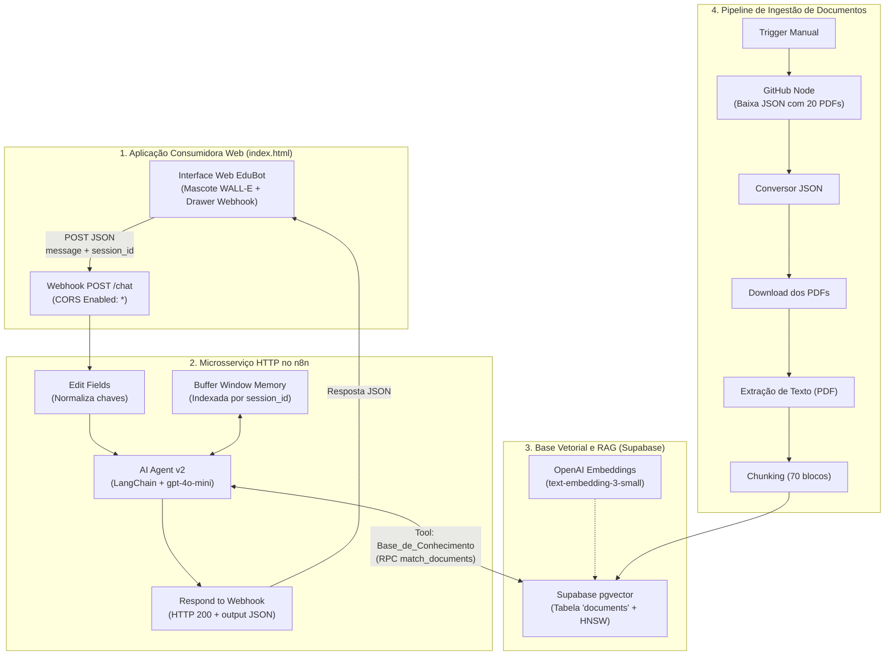

# EA3 — Projeto Final Completo: Solução Integrada de Agente de IA com RAG, Webhooks e Aplicação Consumidora

Solução integrada de Agente de IA consolidando e evoluindo as etapas anteriores (**EA1** e **EA2**). O **EduBot** atua como assistente virtual da **DevAcademy**, combinando raciocínio via LLM, recuperação semântica sobre 20 documentos oficiais com **RAG (Supabase pgvector)**, comunicação desacoplada via **Webhook HTTP** no **n8n** e uma **Aplicação Web Interativa (index.html)** com o mascote WALL-E.

---

## 📌 Identificação Acadêmica

- **Atividade:** EA3 — Projeto Final Completo
- **Aluno / Autor:** Felipe Vieira Saliba Rebouças ([@felipesaliba5-design](https://github.com/felipesaliba5-design))
- **Professor Orientador:** Leandro Vaguetti
- **Disciplina:** Desenvolvimento de Agentes de IA
- **Brasília - DF | 08/11/2026**
- **Plataforma Educacional (Cenário):** DevAcademy (Bootcamps Front-End React e Back-End Node.js)
- **Repositório Oficial EA3:** [https://github.com/felipesaliba5-design/EA3](https://github.com/felipesaliba5-design/EA3)
- **Aplicação Web Online (Vercel):** [https://edubot-phi.vercel.app](https://edubot-phi.vercel.app)

---

## 🔗 Links Oficiais de Entrega e Acesso

1. **Aplicação Web em Produção (Vercel - Acesso Direto sem Download):**  
   👉 [https://edubot-phi.vercel.app](https://edubot-phi.vercel.app)
2. **Repositório do Projeto no GitHub (EA3):**  
   [https://github.com/felipesaliba5-design/EA3](https://github.com/felipesaliba5-design/EA3)
3. **Aplicação Consumidora Web (Código-fonte index.html):**  
   [`index.html`](https://github.com/felipesaliba5-design/EA3/blob/main/index.html)
4. **Workflow Executável do n8n (.json):**  
   [`workflow_edubot.json`](https://github.com/felipesaliba5-design/EA3/blob/main/workflow_edubot.json)
5. **Documento Oficial de Entrega (.txt):**  
   [`ENTREGA_EA3_PROJETO_FINAL_COMPLETO.txt`](https://github.com/felipesaliba5-design/EA3/blob/main/ENTREGA_EA3_PROJETO_FINAL_COMPLETO.txt)
6. **Script DDL Supabase Vector Store:**  
   [`supabase_setup.sql`](https://github.com/felipesaliba5-design/EA3/blob/main/supabase_setup.sql)
7. **Base Documental de 20 PDFs (Catálogo JSON):**  
   [`json Agente de IA no GitHub`](https://github.com/felipesaliba5-design/Constru-o-da-Base-Documental-do-Agente-de-IA/blob/main/json%20Agente%20de%20IA)
8. **Endpoint de Produção do Webhook (Cloud):**  
   `https://n8n.incluc0de.com.br/webhook/chat`

---

## 🏗️ Arquitetura da Solução

---

## 🚀 Como Executar

### 1. Interface Web do Chat
Dê duplo-clique no arquivo [`index.html`](index.html) para abrir no navegador.  
O chat já está apontando para o endpoint na nuvem: `https://n8n.incluc0de.com.br/webhook/chat`.

### 2. Importação no n8n
1. No seu n8n, clique em **Workflows** -> **Import from File**.
2. Selecione o arquivo [`workflow_edubot.json`](workflow_edubot.json).
3. Conecte as credenciais (OpenAI, Supabase, GitHub).
4. Alterne o status para **Active (ON)**.

### 3. Testes Automatizados via Terminal
- **Python:** `python test_webhook.py`
- **PowerShell:** `.\test_webhook.ps1`

---

## 🧪 Casos de Uso Validados

| Caso | Entrada do Aluno | Comportamento do EduBot |
| :--- | :--- | :--- |
| **1. Prazo Oficial** | *"Qual a data limite de entrega do Bootcamp React?"* | Consulta RAG e responde: **05/12/2026 às 23:59**. |
| **2. Pergunta Incompleta** | *"Qual o prazo de entrega do projeto?"* | Triagem pedagógica: pergunta se é Front-End ou Back-End. |
| **3. Dúvida de Código** | *"Corrige esse bug de sintaxe no meu código?"* | Bloqueio didático: recusa e indica mentoria individual 1:1. |
| **4. Pedido de Prorrogação** | *"Pode adiar meu prazo por 3 dias?"* | Nega com empatia, mantendo a isonomia institucional. |
| **5. Bug de Sistema** | *"Erro 500 ao enviar o arquivo na plataforma."* | Coleta e-mail e encaminha chamado exclusivo para TI. |
| **6. Memória Conversacional** | Perguntas sequenciais contextuais | Mantém o histórico sem repetição via `session_id`. |
